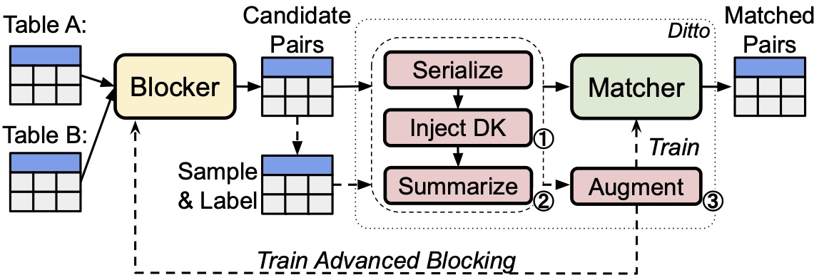

# Ditto: Deep Entity Matching with Pre-Trained Language Models

*Update: a new light-weight version based on new versions of Transformers*

Ditto is an entity matching (EM) solution based on pre-trained language models such as BERT. Given a pair of data entries, EM checks if the two entries refer to the same real-world entities (products, businesses, publications, persons, etc.). Ditto leverages the powerful language understanding capability of pre-trained language models (LMs) via fine-tuning. Ditto serializes each data entry into a text sequence and casts EM as a sequence-pair classification problem solvable by LM fine-tuning. We also employ a set of novel optimizations including summarization, injecting domain-specific knowledge, and data augmentation to further boost the performance of the matching models.

For more technical details, see the [Deep Entity Matching with Pre-Trained Language Models](https://arxiv.org/abs/2004.00584) paper.

## Requirements

* Python 3.10 or newer
* PyTorch 2.3 or newer and HuggingFace Transformers (see the repository's root `requirements.txt`)
* `--fp16` uses PyTorch's built-in automatic mixed precision
* spaCy and the `en_core_web_lg` model are optional and only needed for `--dk`

From the repository root, install the core dependencies with
`python -m pip install -r requirements.txt`. spaCy and the `en_core_web_lg`
model are only needed when using `--dk`.

### Using your own data

Ditto does not split or transform your data automatically. Supply the paths to
your existing train, validation, and test files when training. Each file must
already use Ditto's labeled TSV format: one pair per line, with the serialized
left record, serialized right record, and label (`0` or `1`) separated by tabs.
See [Using Ditto with Our Data](USING_OUR_DATA.md) for the complete data
preparation, training, AMD setup, and matching steps.
From `Methods\ditto`, run:

```powershell
python train_ditto.py --task toponym_experiment `
  --trainset ..\..\datasets\your_data\train.txt `
  --validset ..\..\datasets\your_data\valid.txt `
  --testset ..\..\datasets\your_data\test.txt `
  --lm distilbert --max_len 128 --batch_size 16 --n_epochs 5 --save_model
```

For matching, pass your validation file (used to tune the match threshold) and
a JSONL candidate file. Each candidate JSONL row is a two-element list of
records, for example `[{"id":"a","name":"..."},{"id":"b","name":"..."}]`:

```powershell
python matcher.py --task toponym_experiment `
  --validset ..\..\datasets\your_data\valid.txt `
  --checkpoint_path checkpoints\ `
  --input_path ..\..\datasets\your_data\candidates.jsonl `
  --output_path ..\..\datasets\your_data\predictions.jsonl `
  --lm distilbert --max_len 128
```

If you trained with `--summarize`, also pass the same `--trainset` and
`--testset` paths to the matcher. Custom task names do not include task-specific
settings for domain knowledge injection.

Use the same `--task` name for training and matching; it identifies the
checkpoint directory and need not be added to `configs.json` when the required
data paths are supplied. Existing configured tasks continue to work, and any
of their paths can be overridden with the same options. Add `--class_weighted`
for imbalanced training data. Training uses CUDA/ROCm when available and
otherwise runs on CPU. `--fp16` uses PyTorch AMP and requires a supported GPU
backend. AMD GPUs need a compatible ROCm-enabled PyTorch installation; see
[AMD's PyTorch installation guide](https://rocm.docs.amd.com/projects/ai-ecosystem/en/latest/frameworks/pytorch/install.html).

## The EM pipeline

A typical EM pipeline consists of two phases: blocking and matching. 

The blocking phase typically consists of simple heuristics that reduce the number of candidate pairs to perform the pairwise comparisons. Ditto optimizes the matching phase which performs the actual pairwise comparisons. The input to Ditto consists of a set of labeled candidate data entry pairs. Each data entry is pre-serialized into the following format:
```
COL title VAL microsoft visio standard 2007 version upgrade COL manufacturer VAL microsoft COL price VAL 129.95
```
where ``COL`` and ``VAL`` are special tokens to indicate the starts of attribute names and attribute values. A complete example pair is of the format
```
<entry_1> \t <entry_2> \t <label>
```
where the two entries are serialized and ``<label>`` is either ``0`` (no-match) or ``1`` (match). In our experiments, we evaluated Ditto using two benchmarks:
* the [ER_Magellan benchmarks](https://github.com/anhaidgroup/deepmatcher/blob/master/Datasets.md) used in the [DeepMatcher paper](http://pages.cs.wisc.edu/~anhai/papers1/deepmatcher-sigmod18.pdf). This benchmark contains 13 datasets of 3 categories: ``Structured``, ``Dirty``, and ``Textual`` representing different dataset characteristics. 
* the [WDC product matching benchmark](http://webdatacommons.org/largescaleproductcorpus/v2/index.html). This benchmark contains e-commerce product offering pairs from 4 domains: ``cameras``, ``computers``, ``shoes``, and ``watches``. The training data of each domain is also sub-sampled into different sizes, ``small``, ``medium``, ``large``, and ``xlarge`` to test the label efficiency of the models. 

We provide the serialized version of their datasets in ``data/``. The dataset configurations can be found in ``configs.json``. 

## Training with Ditto

To train the matching model with Ditto:
```
CUDA_VISIBLE_DEVICES=0 python train_ditto.py \
  --task Structured/Beer \
  --batch_size 64 \
  --max_len 64 \
  --lr 3e-5 \
  --n_epochs 40 \
  --lm distilbert \
  --fp16 \
  --da del \
  --dk product \
  --summarize
```
The meaning of the flags:
* ``--task``: the name of the tasks (see ``configs.json``)
* ``--batch_size``, ``--max_len``, ``--lr``, ``--n_epochs``: the batch size, max sequence length, learning rate, and the number of epochs
* ``--lm``: the language model. We now support ``bert``, ``distilbert``, and ``albert`` (``distilbert`` by default).
* ``--fp16``: train with PyTorch automatic mixed precision on a supported GPU
* ``--da``, ``--dk``, ``--summarize``: the 3 optimizations of Ditto. See the followings for details.
* ``--save_model``: if this flag is on, then save the checkpoint to ``{logdir}/{task}/model.pt``.

### Data augmentation (DA)

If the ``--da`` flag is set, then ditto will train the matching model with MixDA, a data augmentation technique for text data. To use data augmentation, one transformation operator needs to be specified. We currently support the following operators for EM:


| Operators       | Details                                           |
|-----------------|---------------------------------------------------|
|del              | Delete a span of tokens                      |
|swap             | Shuffle a span of tokens                          |
|drop_col         | Delete a whole attribute                          |
|append_col       | Move an attribute (append to the end of another attr) |
|all              | Apply all the operators uniformly at random    |

### Domain Knowledge (DK)

Inject domain knowledge to the input sequences if the ``--dk`` flag is set. Ditto will preprocess the serialized entries by
* tagging informative spans (e.g., product ID, persons name) by inserting special tokens (e.g., ID, PERSON)
* normalizing certain spans (e.g., numbers)
We currently support two injection modes: ``--dk general`` and ``--dk product`` for the general domain and for the product domain respectively. See ``ditto/knowledge.py`` for more details.

### Summarization
When the ``--summarize`` flag is set, the input sequence will be summarized by retaining only the high TF-IDF tokens. The resulting sequence will be of length no more than the max sequence length (i.e., ``--max_len``). See ``ditto/summarize.py`` for more details.

## To run the matching models
Use the command:
```
CUDA_VISIBLE_DEVICES=0 python matcher.py \
  --task wdc_all_small \
  --input_path input/input_small.jsonl \
  --output_path output/output_small.jsonl \
  --lm distilbert \
  --max_len 64 \
  --use_gpu \
  --fp16 \
  --checkpoint_path checkpoints/
```
where ``--task`` is the task name, ``--input_path`` is the input file of the candidate pairs in the jsonlines format, ``--output_path`` is the output path, and ``checkpoint_path`` is the path to the model checkpoint (same as ``--logdir`` when training). The language model ``--lm`` and ``--max_len`` should be set to the same as the one used in training. The same ``--dk`` and ``--summarize`` flags also need to be specified if they are used at the training time.

## Colab notebook

You can also run training and prediction using this colab [notebook](https://colab.research.google.com/drive/1eyQbockBSxxQ_tuW5F1XKyeVOM1HT_Ro?usp=sharing).
