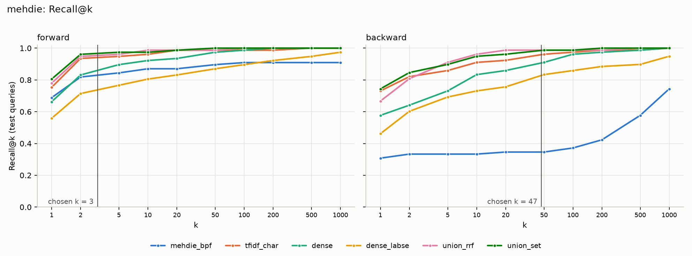
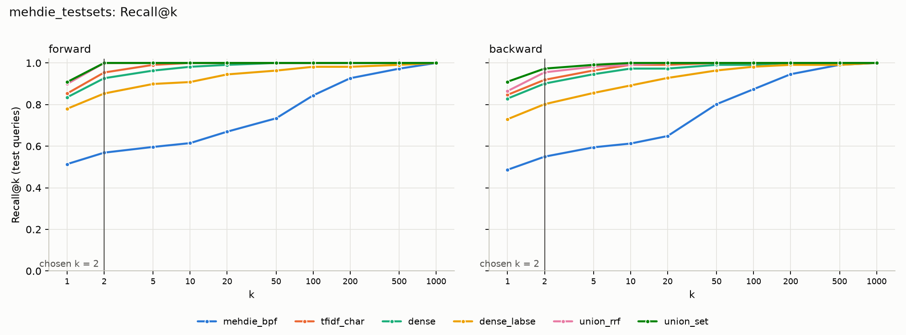
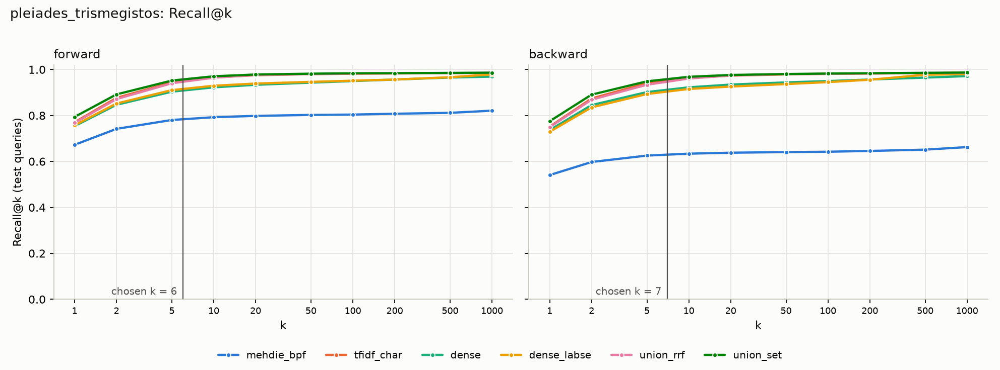

# Candidate generation benchmark

Measures candidate generators on their own and produces a frozen candidate set for the LLM experiments. The LLM only sees what generation passes to it, so generator recall caps end-to-end recall.

All recall here is exact: every query is scored against every target. No existing code or data is changed. Each run hashes its input files before and after, and aborts if any changed.

## Run it

```bash
pip install --no-deps panphon==0.22.2 epitran==1.35.3
pip install -r candidate_generation/requirements.txt
pip install torch==2.15.0 --index-url https://download.pytorch.org/whl/cpu

python -m candidate_generation.run --dataset mehdie
python -m candidate_generation.run --dataset mehdie_testsets
python -m candidate_generation.run --dataset pleiades_trismegistos
python -m candidate_generation.run --dataset all               # add --no-cache to recompute embeddings
python -m candidate_generation.title_only_check                # optional sensitivity check
python -m pytest candidate_generation/tests
```

Everything was run on Python 3.14 on CPU. A full `all` run from a cold cache took about 50 minutes with 12 workers, most of it Pleiades–Trismegistos and LaBSE embedding.

## Layout

| Path | Content |
|---|---|
| `data/` | One adapter per dataset, the common schema, name cleaning, phonetics |
| `generators/` | `mehdie_bpf`, `tfidf_char`, `dense`, `union_rrf` |
| `engine.py` | Scores the full cross product chunk by chunk |
| `metrics.py` | The metrics, as pure functions |
| `frozen.py` | Builds and writes the `real` and `oracle` candidate sets |
| `run.py` | CLI: splits, k selection, reports, plots, manifest |
| `title_only_check.py` | Primary-names-only sensitivity check |
| `config.yaml` | Datasets, directions, seeds, models, k target |
| `results/<dataset>/` | Metrics, coverage, overlap, misses, plots |
| `output/<dataset>/` | Frozen sets, splits, manifest |

## Generators

Generators may read `name`, `name_variants`, `transliteration` and `ipa` only. They receive a `NameTable`, which has no attribute fields. `assert_name_only` runs when a generator class is defined and again at `prepare()`, so a generator declaring `lat`, `lon` or `feature_type` cannot even be defined. A test also confirms that changing those fields leaves every score unchanged.

A record can have several names. Every generator scores a pair by the **best match over both records' names**.

- **`mehdie_bpf`**: our reimplementation of MEHDIE's linguistically motivated blocking. A block is all records with a name containing a sound from one consonant class. Blocks overlap, and a bitmask deduplicates the pairs. The classes are defined over IPA, with a letter map for Hebrew, Arabic and Latin as a fallback. It is set-based; for ranked metrics, candidates are ordered by shared block count, then Jaro similarity on the shared representation. `mehdie_bpf` rows are that ranking cut at k, and `mehdie_bpf_blocks` rows are the whole set.

  | Class | IPA |
  |---|---|
  | labial (the B/P/F class) | p b f v β ɸ |
  | nasal | m n ŋ |
  | dental | t d θ ð |
  | sibilant | s z ʃ ʒ dʒ tʃ ts |
  | velar | k g q x ɣ χ |
  | guttural | ʔ h ħ ʕ |
  | liquid | l r |
  | glide | w j |

- **`tfidf_char`**: TF-IDF over `char_wb` 2–4-grams of the shared IPA representation, with cosine similarity. Set `generators.representation: transliteration` to switch representation.
- **`dense`**: Symphonym v8 (Gadd 2026), a character-level phonetic encoder, with exact cosine search. It loaded on the first try, so the `intfloat/multilingual-e5-base` fallback was not used.
- **`dense_labse`**: the same with `setu4993/LaBSE`.
- **`union_rrf`**: reciprocal rank fusion (constant 60) of `tfidf_char` and `dense`, fused over the full target list rather than truncated lists. `union_rrf_bpf` adds `mehdie_bpf` as the optional third input.
- **`union_set`**: the plain set union of the `tfidf_char` and `dense` top-k lists, so it can hold up to 2k candidates per query.

## Results at the chosen k

All numbers are from **test** queries. k is the smallest value where `union_rrf` reaches recall ≥ 0.95 on **dev** queries, chosen per dataset and direction. Forward is the configured source → target. Pooled rows count pairs across tasks.

PC = pair completeness, PQ = pair quality, RR = reduction ratio. The CI is a 95% Wilson interval on PC. Ground truth lists are incomplete, so PQ is a lower bound. PQ is also low because queries with no ground truth match still contribute candidates.

**`mehdie`, forward: k = 3** (dev recall 0.950 on 20 pairs). Test: 16,309 queries, of which 16,238 have no ground truth match, and 77 ground truth pairs.

| Generator | PC | PC 95% CI | PQ | RR | R@1 | R@2 | R@5 | R@10 | R@20 | R@50 | R@100 | MRR | Mean cand. | Total cand. |
|---|---:|---:|---:|---:|---:|---:|---:|---:|---:|---:|---:|---:|---:|---:|
| mehdie_bpf | 0.831 | 0.732–0.899 | 0.0013 | 0.9996 | 0.688 | 0.818 | 0.844 | 0.870 | 0.870 | 0.896 | 0.909 | 0.796 | 3.0 | 48,927 |
| mehdie_bpf_blocks | 1.000 | 0.952–1.000 | 0.0000 | 0.0525 | 0.688 | 0.818 | 0.844 | 0.870 | 0.870 | 0.896 | 0.909 | 0.796 | 6,894.5 | 112,443,167 |
| tfidf_char | 0.948 | 0.874–0.980 | 0.0015 | 0.9996 | 0.753 | 0.935 | 0.948 | 0.961 | 0.987 | 0.987 | 0.987 | 0.881 | 3.0 | 48,927 |
| dense | 0.896 | 0.808–0.946 | 0.0014 | 0.9996 | 0.662 | 0.831 | 0.896 | 0.922 | 0.935 | 0.974 | 0.987 | 0.806 | 3.0 | 48,927 |
| dense_labse | 0.753 | 0.646–0.836 | 0.0012 | 0.9996 | 0.558 | 0.714 | 0.766 | 0.805 | 0.831 | 0.870 | 0.896 | 0.685 | 3.0 | 48,927 |
| **union_rrf** | 0.961 | 0.892–0.987 | 0.0015 | 0.9996 | 0.779 | 0.948 | 0.961 | 0.987 | 0.987 | 0.987 | 1.000 | 0.903 | 3.0 | 48,927 |
| union_rrf_bpf | 0.896 | 0.808–0.946 | 0.0014 | 0.9996 | 0.727 | 0.870 | 0.948 | 0.987 | 0.987 | 1.000 | 1.000 | 0.858 | 3.0 | 48,927 |
| union_set | 0.974 | 0.910–0.993 | 0.0008 | 0.9992 | 0.805 | 0.961 | 0.974 | 0.974 | 0.987 | 1.000 | 1.000 | – | 5.7 | 92,754 |

**`mehdie`, backward: k = 47** (dev recall 1.000 on 19 pairs). Test: 22,661 queries, of which 22,586 have no ground truth match, and 78 ground truth pairs.

| Generator | PC | PC 95% CI | PQ | RR | R@1 | R@2 | R@5 | R@10 | R@20 | R@50 | R@100 | MRR | Mean cand. | Total cand. |
|---|---:|---:|---:|---:|---:|---:|---:|---:|---:|---:|---:|---:|---:|---:|
| mehdie_bpf | 0.346 | 0.250–0.457 | 0.0000 | 0.9910 | 0.308 | 0.333 | 0.333 | 0.333 | 0.346 | 0.346 | 0.372 | 0.328 | 47.0 | 1,065,020 |
| mehdie_bpf_blocks | 1.000 | 0.953–1.000 | 0.0000 | 0.0530 | 0.308 | 0.333 | 0.333 | 0.333 | 0.346 | 0.346 | 0.372 | 0.328 | 4,959.4 | 112,385,724 |
| tfidf_char | 0.962 | 0.893–0.987 | 0.0001 | 0.9910 | 0.731 | 0.821 | 0.859 | 0.910 | 0.923 | 0.962 | 0.974 | 0.817 | 47.0 | 1,065,028 |
| dense | 0.910 | 0.826–0.956 | 0.0001 | 0.9910 | 0.577 | 0.641 | 0.731 | 0.833 | 0.859 | 0.910 | 0.962 | 0.671 | 47.0 | 1,065,067 |
| dense_labse | 0.833 | 0.735–0.900 | 0.0001 | 0.9910 | 0.462 | 0.603 | 0.692 | 0.731 | 0.756 | 0.833 | 0.859 | 0.591 | 47.0 | 1,065,067 |
| **union_rrf** | 0.987 | 0.931–0.998 | 0.0001 | 0.9910 | 0.667 | 0.808 | 0.910 | 0.962 | 0.987 | 0.987 | 0.987 | 0.791 | 47.0 | 1,065,067 |
| union_rrf_bpf | 0.987 | 0.931–0.998 | 0.0001 | 0.9910 | 0.615 | 0.756 | 0.872 | 0.949 | 0.974 | 0.987 | 0.987 | 0.744 | 47.0 | 1,065,067 |
| union_set | 0.987 | 0.931–0.998 | 0.0000 | 0.9832 | 0.744 | 0.846 | 0.897 | 0.949 | 0.962 | 0.987 | 0.987 | – | 88.1 | 1,997,342 |


**`mehdie_testsets`, forward: k = 2** (dev recall 0.964 on 28 pairs). Test: 3,057 queries, of which 2,948 have no ground truth match, and 109 ground truth pairs.

| Generator | PC | PC 95% CI | PQ | RR | R@1 | R@2 | R@5 | R@10 | R@20 | R@50 | R@100 | MRR | Mean cand. | Total cand. |
|---|---:|---:|---:|---:|---:|---:|---:|---:|---:|---:|---:|---:|---:|---:|
| mehdie_bpf | 0.569 | 0.475–0.658 | 0.0101 | 0.9974 | 0.514 | 0.569 | 0.596 | 0.615 | 0.670 | 0.734 | 0.844 | 0.561 | 2.0 | 6,114 |
| mehdie_bpf_blocks | 1.000 | 0.966–1.000 | 0.0000 | 0.0419 | 0.514 | 0.569 | 0.596 | 0.615 | 0.670 | 0.734 | 0.844 | 0.561 | 738.8 | 2,258,473 |
| tfidf_char | 0.954 | 0.897–0.980 | 0.0170 | 0.9974 | 0.853 | 0.954 | 0.991 | 1.000 | 1.000 | 1.000 | 1.000 | 0.916 | 2.0 | 6,114 |
| dense | 0.927 | 0.862–0.962 | 0.0165 | 0.9974 | 0.835 | 0.927 | 0.963 | 0.982 | 0.991 | 1.000 | 1.000 | 0.896 | 2.0 | 6,114 |
| dense_labse | 0.853 | 0.775–0.908 | 0.0152 | 0.9974 | 0.780 | 0.853 | 0.899 | 0.908 | 0.945 | 0.963 | 0.982 | 0.831 | 2.0 | 6,114 |
| **union_rrf** | 1.000 | 0.966–1.000 | 0.0178 | 0.9974 | 0.899 | 1.000 | 1.000 | 1.000 | 1.000 | 1.000 | 1.000 | 0.950 | 2.0 | 6,114 |
| union_rrf_bpf | 0.780 | 0.693–0.847 | 0.0139 | 0.9974 | 0.624 | 0.780 | 0.945 | 0.991 | 1.000 | 1.000 | 1.000 | 0.753 | 2.0 | 6,114 |
| union_set | 1.000 | 0.966–1.000 | 0.0096 | 0.9952 | 0.908 | 1.000 | 1.000 | 1.000 | 1.000 | 1.000 | 1.000 | – | 3.7 | 11,380 |

**`mehdie_testsets`, backward: k = 2** (dev recall 1.000 on 26 pairs). Test: 4,237 queries, of which 4,131 have no ground truth match, and 111 ground truth pairs.

| Generator | PC | PC 95% CI | PQ | RR | R@1 | R@2 | R@5 | R@10 | R@20 | R@50 | R@100 | MRR | Mean cand. | Total cand. |
|---|---:|---:|---:|---:|---:|---:|---:|---:|---:|---:|---:|---:|---:|---:|
| mehdie_bpf | 0.550 | 0.457–0.639 | 0.0072 | 0.9964 | 0.486 | 0.550 | 0.595 | 0.613 | 0.649 | 0.802 | 0.874 | 0.552 | 2.0 | 8,474 |
| mehdie_bpf_blocks | 1.000 | 0.967–1.000 | 0.0000 | 0.0417 | 0.486 | 0.550 | 0.595 | 0.613 | 0.649 | 0.802 | 0.874 | 0.552 | 534.0 | 2,262,395 |
| tfidf_char | 0.919 | 0.853–0.957 | 0.0120 | 0.9964 | 0.847 | 0.919 | 0.964 | 0.991 | 0.991 | 1.000 | 1.000 | 0.921 | 2.0 | 8,474 |
| dense | 0.901 | 0.831–0.944 | 0.0118 | 0.9964 | 0.829 | 0.901 | 0.946 | 0.973 | 0.973 | 0.991 | 0.991 | 0.904 | 2.0 | 8,474 |
| dense_labse | 0.802 | 0.718–0.865 | 0.0105 | 0.9964 | 0.730 | 0.802 | 0.856 | 0.892 | 0.928 | 0.964 | 0.982 | 0.814 | 2.0 | 8,474 |
| **union_rrf** | 0.955 | 0.899–0.981 | 0.0125 | 0.9964 | 0.865 | 0.955 | 0.982 | 0.991 | 1.000 | 1.000 | 1.000 | 0.941 | 2.0 | 8,474 |
| union_rrf_bpf | 0.829 | 0.748–0.888 | 0.0109 | 0.9964 | 0.694 | 0.829 | 0.937 | 0.991 | 1.000 | 1.000 | 1.000 | 0.820 | 2.0 | 8,474 |
| union_set | 0.973 | 0.924–0.991 | 0.0068 | 0.9933 | 0.910 | 0.973 | 0.991 | 1.000 | 1.000 | 1.000 | 1.000 | – | 3.7 | 15,867 |


**`pleiades_trismegistos`, forward: k = 6** (dev recall 0.953 on 2775 pairs). Test: 33,934 queries, of which 23,001 have no ground truth match, and 11,115 ground truth pairs.

| Generator | PC | PC 95% CI | PQ | RR | R@1 | R@2 | R@5 | R@10 | R@20 | R@50 | R@100 | MRR | Mean cand. | Total cand. |
|---|---:|---:|---:|---:|---:|---:|---:|---:|---:|---:|---:|---:|---:|---:|
| mehdie_bpf | 0.785 | 0.777–0.793 | 0.0480 | 0.9999 | 0.672 | 0.742 | 0.780 | 0.793 | 0.798 | 0.803 | 0.804 | 0.732 | 5.4 | 181,620 |
| mehdie_bpf_blocks | 0.999 | 0.998–1.000 | 0.0000 | 0.1438 | 0.672 | 0.742 | 0.780 | 0.793 | 0.798 | 0.803 | 0.804 | 0.732 | 55,229.5 | 1,874,158,956 |
| tfidf_char | 0.951 | 0.947–0.955 | 0.0582 | 0.9999 | 0.771 | 0.877 | 0.944 | 0.966 | 0.975 | 0.980 | 0.982 | 0.857 | 5.4 | 181,692 |
| dense | 0.910 | 0.904–0.915 | 0.0557 | 0.9999 | 0.754 | 0.847 | 0.904 | 0.923 | 0.934 | 0.943 | 0.950 | 0.831 | 5.4 | 181,692 |
| dense_labse | 0.916 | 0.911–0.921 | 0.0561 | 0.9999 | 0.758 | 0.852 | 0.910 | 0.929 | 0.939 | 0.946 | 0.952 | 0.835 | 5.4 | 181,692 |
| **union_rrf** | 0.948 | 0.944–0.952 | 0.0580 | 0.9999 | 0.768 | 0.871 | 0.940 | 0.964 | 0.977 | 0.980 | 0.983 | 0.854 | 5.4 | 181,692 |
| union_rrf_bpf | 0.940 | 0.936–0.945 | 0.0575 | 0.9999 | 0.744 | 0.849 | 0.932 | 0.957 | 0.971 | 0.980 | 0.982 | 0.835 | 5.4 | 181,692 |
| union_set | 0.959 | 0.955–0.962 | 0.0320 | 0.9998 | 0.794 | 0.892 | 0.952 | 0.971 | 0.978 | 0.982 | 0.984 | – | 9.8 | 332,989 |

**`pleiades_trismegistos`, backward: k = 7** (dev recall 0.959 on 2785 pairs). Test: 51,606 queries, of which 40,889 have no ground truth match, and 11,105 ground truth pairs.

| Generator | PC | PC 95% CI | PQ | RR | R@1 | R@2 | R@5 | R@10 | R@20 | R@50 | R@100 | MRR | Mean cand. | Total cand. |
|---|---:|---:|---:|---:|---:|---:|---:|---:|---:|---:|---:|---:|---:|---:|
| mehdie_bpf | 0.630 | 0.621–0.639 | 0.0194 | 0.9998 | 0.541 | 0.597 | 0.625 | 0.634 | 0.638 | 0.641 | 0.642 | 0.596 | 7.0 | 360,731 |
| mehdie_bpf_blocks | 0.999 | 0.999–1.000 | 0.0000 | 0.1424 | 0.541 | 0.597 | 0.625 | 0.634 | 0.638 | 0.641 | 0.642 | 0.596 | 36,375.7 | 1,877,203,995 |
| tfidf_char | 0.953 | 0.949–0.957 | 0.0293 | 0.9998 | 0.751 | 0.874 | 0.941 | 0.963 | 0.973 | 0.979 | 0.981 | 0.856 | 7.0 | 360,801 |
| dense | 0.914 | 0.909–0.919 | 0.0281 | 0.9998 | 0.737 | 0.845 | 0.902 | 0.923 | 0.935 | 0.944 | 0.950 | 0.832 | 7.0 | 360,801 |
| dense_labse | 0.905 | 0.900–0.910 | 0.0279 | 0.9998 | 0.729 | 0.835 | 0.893 | 0.915 | 0.926 | 0.937 | 0.945 | 0.824 | 7.0 | 360,801 |
| **union_rrf** | 0.948 | 0.944–0.952 | 0.0292 | 0.9998 | 0.749 | 0.869 | 0.934 | 0.961 | 0.974 | 0.980 | 0.981 | 0.853 | 7.0 | 360,801 |
| union_rrf_bpf | 0.932 | 0.927–0.936 | 0.0287 | 0.9998 | 0.636 | 0.775 | 0.906 | 0.947 | 0.965 | 0.978 | 0.981 | 0.769 | 7.0 | 360,801 |
| union_set | 0.960 | 0.956–0.964 | 0.0156 | 0.9997 | 0.775 | 0.891 | 0.949 | 0.968 | 0.976 | 0.980 | 0.983 | – | 13.2 | 682,751 |


### `union_rrf` per task

| Dataset | Task | Direction | k | Pairs | PC | MRR |
|---|---|---|---:|---:|---:|---:|
| mehdie | yaqut_kima | forward | 3 | 62 | 0.952 | 0.914 |
| mehdie | thurayya_kima | forward | 3 | 8 | 1.000 | 0.857 |
| mehdie | thurayya_yaqut | forward | 3 | 7 | 1.000 | 0.857 |
| mehdie | yaqut_kima | backward | 47 | 63 | 0.984 | 0.748 |
| mehdie | thurayya_kima | backward | 47 | 8 | 1.000 | 0.938 |
| mehdie | thurayya_yaqut | backward | 47 | 7 | 1.000 | 1.000 |
| mehdie_testsets | ts7_yaqut_kima_sham | forward | 2 | 26 | 1.000 | 0.962 |
| mehdie_testsets | ts8_kima_thurayya_sham | forward | 2 | 17 | 1.000 | 1.000 |
| mehdie_testsets | ts9_tudela_thurayya | forward | 2 | 14 | 1.000 | 0.964 |
| mehdie_testsets | ts10_yaqut_kima_maghreb | forward | 2 | 26 | 1.000 | 0.865 |
| mehdie_testsets | ts11_damast_tudela | forward | 2 | 26 | 1.000 | 0.981 |
| mehdie_testsets | ts7_yaqut_kima_sham | backward | 2 | 27 | 0.889 | 0.858 |
| mehdie_testsets | ts8_kima_thurayya_sham | backward | 2 | 17 | 1.000 | 0.938 |
| mehdie_testsets | ts9_tudela_thurayya | backward | 2 | 14 | 1.000 | 1.000 |
| mehdie_testsets | ts10_yaqut_kima_maghreb | backward | 2 | 27 | 0.926 | 0.930 |
| mehdie_testsets | ts11_damast_tudela | backward | 2 | 26 | 1.000 | 1.000 |

Other tables are in `results/<dataset>/`: `metrics.csv` (every generator, per task), `overlap_counts.csv` and `overlap_pairs.csv` (which generators retrieved each pair), and `misses/<generator>.csv` (missed pairs with names, IPA and rank).

### Recall@k plots

`mehdie_bpf_blocks` has no curve, because it is one unranked set. `union_rrf_bpf` is left out of the plots for legibility; its numbers are in the tables.







## How to read these results

1. **Pleiades–Trismegistos test recall is just under target.** `union_rrf` reached 0.95 on dev, but test PC is 0.948 in both directions. k was not retuned on test. To clear 0.95 on test, raise `target_recall` slightly, or use `union_set`, at about twice the candidates.
2. **`union_rrf` is not always the best generator.** On Pleiades–Trismegistos, `tfidf_char` alone beats it at the same k (0.951 vs 0.948 forward, 0.953 vs 0.948 backward), because most pairs are near-identical Latin strings.
3. **The `mehdie` k values rest on few pairs.** Each dev set has about 20 pairs. Backward, 95% of 19 pairs means all 19, so a single outlier set k = 47. Treat those k values as rough, and note the wide CIs.
4. **`mehdie_bpf` does not reduce much as blocking.** Its full blocks keep nearly all pairs but remove only 4–14% of the cross product, because almost any two names share one of eight classes. Its ranking is weak, and adding it to fusion lowers recall (`union_rrf_bpf`).
5. **Some pairs need no cross-script matching.** Gazetteers often list the other side's form among their variants, so a pair can match on an identical string:

| Dataset | Task | Pairs | Share an exact name | Share an IPA form |
|---|---|---:|---:|---:|
| mehdie | yaqut_kima | 78 | 1 (1.3%) | 54 (69.2%) |
| mehdie | thurayya_kima | 10 | 3 (30.0%) | 6 (60.0%) |
| mehdie | thurayya_yaqut | 9 | 8 (88.9%) | 8 (88.9%) |
| mehdie_testsets | ts7_yaqut_kima_sham | 33 | 0 (0.0%) | 23 (69.7%) |
| mehdie_testsets | ts8_kima_thurayya_sham | 21 | 11 (52.4%) | 16 (76.2%) |
| mehdie_testsets | ts9_tudela_thurayya | 18 | 14 (77.8%) | 16 (88.9%) |
| mehdie_testsets | ts10_yaqut_kima_maghreb | 33 | 0 (0.0%) | 22 (66.7%) |
| mehdie_testsets | ts11_damast_tudela | 32 | 26 (81.2%) | 29 (90.6%) |
| pleiades_trismegistos | pleiades_trismegistos | 13,890 | 11,931 (85.9%) | 12,243 (88.1%) |

   Pleiades–Trismegistos is mostly a same-script task by this measure, so its recall says little about cross-script ability. On the paper's testsets, using primary names only shows how much the variants contribute (unweighted mean of five testsets, forward):

| Generator | Names used | R@1 | R@10 | MRR |
|---|---|---:|---:|---:|
| dense | all_variants | 0.880 | 0.982 | 0.922 |
| dense | primary_only | 0.693 | 0.881 | 0.763 |
| tfidf_char | all_variants | 0.888 | 1.000 | 0.934 |
| tfidf_char | primary_only | 0.739 | 0.906 | 0.802 |

6. **Published results are reproduced.** With all variants, `dense` gets R@1 0.880, R@10 0.982 and MRR 0.922 on the five testsets, against 0.893, 0.982 and 0.928 on the Symphonym v8 model card. The small gap could come from version or setup differences; we did not investigate it.
7. **Some misses are not generator errors.** The `mehdie` misses include `همدان` (Hamadan) ↔ `קבוץ חנתון` (Kibbutz Hanaton), which looks like a wrong link. In Pleiades–Trismegistos, 4 ground truth pairs have a Pleiades query with no usable name, and many others link unrelated names (`Latopolis` ↔ `Deir el-Shuhada`), which name-based generation cannot find. These pairs were kept, so measured recall is conservative. They are worth a manual review.

## Field coverage

No dataset provides IPA, so every IPA value is derived. "Translit. in dataset" means the record has at least one Latin-script name. For the others, transliteration comes from AnyAscii.

| Dataset | Source | Records | Name | Variants | Names per record | Translit. in dataset | Translit. derived | IPA in dataset | IPA derived (any name) | Coordinates | Feature type |
|---|---|---:|---:|---:|---:|---:|---:|---:|---:|---:|---:|
| mehdie | kima | 6,211 | 100.0% | 92.8% | 3.94 | 96.4% | 3.6% | 0.0% | 100.0% | 59.5% | 5.3% |
| mehdie | yaqut | 15,904 | 100.0% | 1.1% | 1.01 | 0.0% | 100.0% | 0.0% | 100.0% | 16.8% | 90.5% |
| mehdie | thurayya | 2,241 | 100.0% | 100.0% | 3.58 | 100.0% | 0.0% | 0.0% | 100.0% | 100.0% | 100.0% |
| mehdie_testsets | ts7_yaqut_kima_sham:yaqut | 687 | 100.0% | 3.6% | 1.04 | 0.0% | 100.0% | 0.0% | 100.0% | 42.6% | 95.3% |
| mehdie_testsets | ts7_yaqut_kima_sham:kima | 1,899 | 100.0% | 100.0% | 4.47 | 100.0% | 0.1% | 0.0% | 100.0% | 89.3% | 1.5% |
| mehdie_testsets | ts8_kima_thurayya_sham:kima | 1,899 | 100.0% | 100.0% | 4.47 | 100.0% | 0.1% | 0.0% | 100.0% | 89.3% | 1.5% |
| mehdie_testsets | ts8_kima_thurayya_sham:thurayya | 291 | 100.0% | 100.0% | 3.57 | 100.0% | 0.0% | 0.0% | 100.0% | 100.0% | 100.0% |
| mehdie_testsets | ts9_tudela_thurayya:tudela | 306 | 100.0% | 95.8% | 4.71 | 96.4% | 3.6% | 0.0% | 100.0% | 57.2% | 0.0% |
| mehdie_testsets | ts9_tudela_thurayya:thurayya | 2,241 | 100.0% | 100.0% | 3.57 | 100.0% | 0.0% | 0.0% | 100.0% | 100.0% | 100.0% |
| mehdie_testsets | ts10_yaqut_kima_maghreb:yaqut | 484 | 100.0% | 1.0% | 1.01 | 0.0% | 100.0% | 0.0% | 100.0% | 47.3% | 93.6% |
| mehdie_testsets | ts10_yaqut_kima_maghreb:kima | 559 | 100.0% | 100.0% | 3.96 | 100.0% | 0.0% | 0.0% | 100.0% | 100.0% | 10.7% |
| mehdie_testsets | ts11_damast_tudela:damast | 447 | 100.0% | 99.8% | 9.31 | 100.0% | 0.0% | 0.0% | 100.0% | 96.4% | 100.0% |
| mehdie_testsets | ts11_damast_tudela:tudela | 306 | 100.0% | 95.8% | 4.71 | 96.4% | 3.6% | 0.0% | 100.0% | 57.2% | 0.0% |
| pleiades_trismegistos | pleiades | 42,417 | 89.3% | 28.1% | 1.63 | 89.3% | 0.0% | 0.0% | 89.3% | 82.1% | 100.0% |
| pleiades_trismegistos | trismegistos | 64,507 | 99.9% | 37.6% | 1.55 | 99.9% | 0.0% | 0.0% | 99.9% | 38.2% | 39.5% |

IPA by script:

| Script | Method |
|---|---|
| Arabic | Epitran `ara-Arab`, then cleanup for what it leaves raw (e.g. `ة`) |
| Hebrew, Greek, Coptic | Our rule tables in `data/phonetics.py`. The installed Epitran has no map for them |
| Latin | Our rule table, because these are scholarly transliterations (ḥ, ṣ, ǧ, ŧ) and Latinised Greek, not a modern language |
| Others (Syriac, Cyrillic, ...) | AnyAscii, then the Latin table |

## Queries with no ground truth match

Excluded from recall, included in the reduction ratio and in the frozen sets.

| Dataset | Task | Direction | Queries | No ground truth match | Excluded from recall, included in RR |
|---|---|---|---:|---:|---:|
| mehdie | thurayya_kima | backward | 6,211 | 6,201 | 99.8% |
| mehdie | thurayya_kima | forward | 2,241 | 2,232 | 99.6% |
| mehdie | thurayya_yaqut | backward | 15,904 | 15,895 | 99.9% |
| mehdie | thurayya_yaqut | forward | 2,241 | 2,232 | 99.6% |
| mehdie | yaqut_kima | backward | 6,211 | 6,136 | 98.8% |
| mehdie | yaqut_kima | forward | 15,904 | 15,833 | 99.6% |
| mehdie_testsets | ts10_yaqut_kima_maghreb | backward | 559 | 527 | 94.3% |
| mehdie_testsets | ts10_yaqut_kima_maghreb | forward | 484 | 451 | 93.2% |
| mehdie_testsets | ts11_damast_tudela | backward | 306 | 274 | 89.5% |
| mehdie_testsets | ts11_damast_tudela | forward | 447 | 415 | 92.8% |
| mehdie_testsets | ts7_yaqut_kima_sham | backward | 1,899 | 1,869 | 98.4% |
| mehdie_testsets | ts7_yaqut_kima_sham | forward | 687 | 654 | 95.2% |
| mehdie_testsets | ts8_kima_thurayya_sham | backward | 291 | 271 | 93.1% |
| mehdie_testsets | ts8_kima_thurayya_sham | forward | 1,899 | 1,878 | 98.9% |
| mehdie_testsets | ts9_tudela_thurayya | backward | 2,241 | 2,223 | 99.2% |
| mehdie_testsets | ts9_tudela_thurayya | forward | 306 | 288 | 94.1% |
| pleiades_trismegistos | pleiades_trismegistos | backward | 64,507 | 51,111 | 79.2% |
| pleiades_trismegistos | pleiades_trismegistos | forward | 42,417 | 28,751 | 67.8% |

## Frozen candidate sets

Files are in `output/<dataset>/`, one set per task and direction, for example `yaqut_kima.forward.real.v1.parquet`.

| File | Content |
|---|---|
| `<task>.<direction>.real.v1.parquet` | Exactly what `union_rrf` returns at the chosen k |
| `<task>.<direction>.oracle.v1.parquet` | The same set, plus any missing true match |
| `<task>.<direction>.splits.v1.parquet` | `query_id`, `split` (dev/test), `has_ground_truth` |
| `manifest.v1.json` | Config, seeds, models and revisions, chosen k, SHA256 of each output and input file, timestamp |

Columns: `query_id, candidate_id, generator, rank, score, k, is_ground_truth, oracle_injected, shuffle_position`.

```python
import pandas as pd

folder = "candidate_generation/output/mehdie"
real = pd.read_parquet(f"{folder}/yaqut_kima.forward.real.v1.parquet")
oracle = pd.read_parquet(f"{folder}/yaqut_kima.forward.oracle.v1.parquet")
splits = pd.read_parquet(f"{folder}/yaqut_kima.forward.splits.v1.parquet")

# Keep test queries. Dev queries were used to choose k.
test_ids = splits.loc[splits.split == "test", "query_id"]
real = real[real.query_id.isin(test_ids)]

# Candidates for one query, in the order to present them in a list-style prompt.
query = real[real.query_id == "dig12596"].sort_values("shuffle_position")
```

- Use `rank` as the canonical order and `shuffle_position` for presentation order. Both are 1-based.
- Don't show `score`, `generator`, `is_ground_truth`, `oracle_injected` or `rank` to the LLM. They reveal the answer or the injected row.
- In `oracle`, an injected row has `generator = "oracle"` and a null `score`. Its rank and shuffle position are both seeded random. All other candidates keep their relative order in both, so `real` and `oracle` differ only by the injection. A query with several missing matches gets all of them.
- Candidates come from `union_rrf` on names alone, and nothing in the build knows about prompts, so the files are identical whichever attributes later go into a prompt.

## Reproducibility

All randomness derives from `seed` in the config, hashed with a stable key per query, so results do not depend on processing order. Ties break by a seeded target order, unrelated to record ids. Scores are rounded before ranking, and each scoring chunk runs single-threaded.

Verified: a second `all` run with embeddings recomputed produced byte-identical files for all 54 parquet outputs. The manifest differs only by its timestamp, which is why it is excluded from `output digest`. This was verified on one machine with one set of package versions. A different torch or BLAS build may change low-order digits.

## Assumptions

**Data**

- `mehdie` is `../final_datasets/MEHDIE`. No loaders existed to reuse: `scripts/attribute_overlap.py` runs on import, and other scripts build data rather than load it.
- Places repeat across MEHDIE rows (Kima: 14,341 rows, 6,211 src_ids; al-Thurayya: each place twice). Ground truth points at one arbitrary row, so a retrieved duplicate would count as a miss. Rows are merged per `src_id`, merging their names, and `record_id` is the `src_id`.
- Ground truth for `mehdie` is `same_as` from the internal links file. That gives 105 place pairs. **8 are also labelled `different`** after merging and are excluded by default (`conflict_policy: exclude`), leaving 97. They are listed in the manifest.
- The `links` columns, Wikidata and GeoNames links and Tudela's ids are never read, because they leak matches.
- `mehdie` has three tasks: Yāqūt–Kima, al-Thurayya–Kima, al-Thurayya–Yāqūt. k is selected once per direction, pooled across them, because the two smaller tasks have only about 2 dev pairs each.
- `mehdie_testsets` is an addition: the five testsets of Sagi et al. (2025) from `datasets/MEHDIE`. They overlap the DB extract only partly (68 shared pairs, 19 only here, 37 only in the extract) and are the only source for Tudela and DAMAST, so they are a separate dataset and not merged. `YaqutTudela/em.tsv` is derived data and not used.
- Other folders in `datasets/` are not included: they aren't in `final_datasets/` and have no `em.tsv` cross-source ground truth in the same form. That includes `tgaz_csv` and `chgis_ras`, which arrived from `origin/main` while this was being built.
- Trismegistos `ethnicon` is left out: demonyms are derived forms, not place names.

**Names**

- Attributes must not reach generators through names. Parentheses after a Pleiades title (`Aethusa (island)`, `(Roman province)`) and brackets after a Trismegistos name (`[Tebtynis]`) are removed.
- `Untitled` and `Unnamed ...` titles are dropped, because their text is a type label. 4,517 Pleiades and 75 Trismegistos records end up with no usable name. They stay in the data and are never retrieved.
- Parentheses attached to a word are spelling variants (`Ap(p)enninus` gives both forms). Editorial marks are removed but restored letters kept (`Taproba[n]e`). Names with fewer than two letters are dropped.
- Type words **inside** a name can't be separated from it and remain (`Temple of ...`, `Fundus ...`, Kima `... Site`). This is a known small leak of feature type into names.
- A free-standing parenthesis is removed even when it holds an alternative name, so a few alternatives are lost.

**Evaluation**

- Dev and test are split 20/80 per task and direction, stratified on having a ground truth match, with a fixed seed.
- Recall and MRR use queries with ground truth. RR and candidate counts use all queries in the split.
- The k search runs over all integers up to `max_k` = 1000, not only the listed k values.
- `is_ground_truth` covers listed pairs only. Candidates that are true but unlisted count as wrong.
- TF-IDF is fitted on both sides of a task without labels.
- `dense` uses `und` as the language code, because no per-name language exists. Symphonym's tokeniser reports 7 out-of-range vocabulary ids mapped to unknown, which comes from the model files.
- `union_set` is compared at the same per-generator k, so its candidate lists are longer than the others.

**Models**

- The task named Symphonym without a version. v8 is used because the v7 card marks it as superseded and v8 fixes a tokeniser bug. The revision is pinned in the config, and `inference.py` was read before use. Symphonym's model card states that MEHDIE was not in its training data; we could not verify that independently, and its training sources may include modern forms of the same places.
- Symphonym v8 is licensed CC BY 4.0, and its licence asks for this citation: World Historical Gazetteer, *Symphonym: Universal Phonetic Embeddings for Cross-Script Name Matching — Models and Evaluation Data*. Zenodo. https://doi.org/10.5281/zenodo.18682017. It also asks that GeoNames and Getty TGN be credited.

## Known limitations

- **The MEHDIE consonant classes are ours.** Only B/P/F comes from the task description. The paper's full text could not be retrieved, so the other seven classes were not checked against it, and this may differ from MEHDIE's actual blocking. If you have the paper, compare them against the class table above; they are defined in `generators/mehdie_bpf.py`.
- Rule-based G2P is approximate and has not been evaluated by a phonologist. Hebrew and Arabic spellings are unvocalised, so derived IPA lacks most vowels.
- `editdistance` does not build on Python 3.14, so `panphon` and `epitran` are installed with `--no-deps`. The code doesn't use it.
- Runs are CPU only. No GPU was available.
