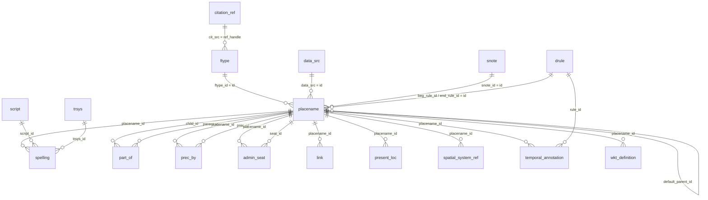

# TGaz database schema and table links

This document summarizes the schema in the TGaz 2018 SQL dump. It focuses on
how records connect, rather than reproducing every column definition.

## Core relationship map

The diagram shows only foreign-key links present in the dump. A foreign key
ensures that a referenced row exists, but does not prevent multiple referencing
rows unless a separate uniqueness constraint is declared.

## Declared foreign keys

| Referencing table.column | Referenced table.column | Meaning |
|---|---|---|
| `ftype.cit_src` | `citation_ref.ref_handle` | Feature-type citation |
| `placename.ftype_id` | `ftype.id` | Place feature type |
| `placename.data_src` | `data_src.id` | Place data source |
| `placename.snote_id` | `snote.id` | Place source note |
| `placename.alt_of_id` | `placename.id` | Place this record is an alternate of |
| `placename.beg_rule_id` | `drule.id` | Rule for interpreting the beginning date |
| `placename.end_rule_id` | `drule.id` | Rule for interpreting the ending date |
| `placename.default_parent_id` | `placename.id` | Default parent place |
| `spelling.placename_id` | `placename.id` | Place named by the spelling |
| `spelling.script_id` | `script.id` | Writing system/script |
| `spelling.trsys_id` | `trsys.id` | Transcription system |
| `part_of.child_id` | `placename.id` | Child in a time-bounded hierarchy relation |
| `part_of.parent_id` | `placename.id` | Parent in a time-bounded hierarchy relation |
| `prec_by.placename_id` | `placename.id` | Place whose history is being described |
| `prec_by.prec_id` | `placename.id` | Preceding place/name |
| `admin_seat.placename_id` | `placename.id` | Place associated with the seat relation |
| `admin_seat.seat_id` | `placename.id` | Place serving as the seat |
| `link.placename_id` | `placename.id` | External link for a place |
| `present_loc.placename_id` | `placename.id` | Present-location assertion for a place |
| `spatial_system_ref.placename_id` | `placename.id` | External spatial-system reference |
| `temporal_annotation.placename_id` | `placename.id` | Temporal assertion for a place |
| `temporal_annotation.rule_id` | `drule.id` | Rule used by the temporal assertion |
| `wkt_definition.placename_id` | `placename.id` | WKT geometry for a place |

## How the core records fit together

- **`placename` is the hub.** Its `id` is referenced by the name, hierarchy,
  predecessor, geometry, temporal, external-link, and location records.
- **Names and representations:** `spelling` stores a written form for a place.
  Its `script_id` and `trsys_id` connect that form to the `script` and `trsys`
  lookup tables. `exonym_lang`, `default_per_type`, and `attested_by` qualify
  the spelling; they are not foreign keys in this dump.
- **Hierarchy:** `part_of` connects a child place to a parent place and carries
  `begin_year` and `end_year`. `placename.default_parent_id` is a separate
  self-reference for a default parent.
- **Predecessors:** `prec_by` connects a place (`placename_id`) to a preceding
  place (`prec_id`). Do not confuse `prec_id` with the subject place.
- **Feature types and sources:** each place points to a `ftype`, `data_src`,
  and optionally an `snote`. A feature type can point to its citation through
  `ftype.cit_src`.
- **Dates:** place begin/end rule IDs and temporal-annotation rule IDs point to
  `drule`, which stores the rule definitions.
- **Spatial and administrative details:** `wkt_definition` stores WKT geometry
  for a place. `geom` also has a `placename_id` column, but the dump does not
  declare a foreign key for it. `present_loc` and `spatial_system_ref` hold
  location assertions/references; `admin_seat` links two place records in a
  seat relationship. These are distinct relation types.

## Views and their joins

The dump defines five views over the core tables:

| View | Base tables and join paths | What it exposes |
|---|---|---|
| `v_placename` | `placename` → `ftype` (inner join); `placename` → `snote` (left join) | Place fields with feature-type labels and source-note details |
| `v_spelling` | `spelling` → `script`; `spelling` → `trsys` | Spellings with script and transcription-system labels |
| `v_children` | `part_of.child_id` → `placename.id`; then spellings for that place | Child hierarchy rows with child system ID and selected Vietnamese/transcription forms |
| `v_partof` | `part_of.parent_id` → `placename.id`; then spellings for that place | Parent hierarchy rows with parent system ID and selected forms |
| `v_precby` | `prec_by.prec_id` → `placename.id`; then spellings for that preceding place | Predecessor rows with the preceding place's system ID and selected forms |

The three hierarchy/predecessor views use `spelling` more than once to select
display forms. Their SQL filters those forms to default spellings and selected
script/transcription values. The view output is therefore a presentation
projection, not a complete list of all spellings.

## Other tables and non-enforced links

The dump also contains legacy/import and search-oriented tables. They are not
shown as foreign-key edges because the dump does not declare foreign keys for
them.

| Tables | Role / connection notes |
|---|---|
| `alt_name3`, `main_xx`, `gis_xx`, `partof_xx`, `precby_xx`, `ftype_xx`, `snote_xx` | Legacy or import-shaped records. Their names and fields resemble core concepts, but the dump does not establish their joins to the normalized tables with foreign keys. |
| `f2`, `ck1`, `tbt_rev` | Auxiliary coordinate/name tables; `name_id` or `sys_id` fields may be used by application/import logic, but no foreign keys are declared. |
| `v5_id`, `v6_id` | Version-ID lookup tables with unique `sys_id` values; the dump does not constrain them to `placename.sys_id`. |
| `mv_pn_srch`, `mv_pn_srch_new_test`, `mv_pn_srch_old` | Search-oriented denormalized tables containing place names, transcription, date, coordinate, feature-type, and/or parent fields. Treat their IDs as snapshot/search data, not declared foreign-key relations. |
| `ftype_xx`, `snote_xx`, `gis_xx`, `partof_xx`, `precby_xx` | The `_xx` suffix tables include staging/import fields and should not be mistaken for the normalized `ftype`, `snote`, `part_of`, or `prec_by` relations. |

Some similarly named columns suggest application-level joins—for example,
`sys_id` across `placename` and legacy/search tables, or `data_src_ref` as a
source-specific identifier. These are conventions rather than enforced
relationships in this dump; verify the originating import/application logic
before relying on them as stable keys.
